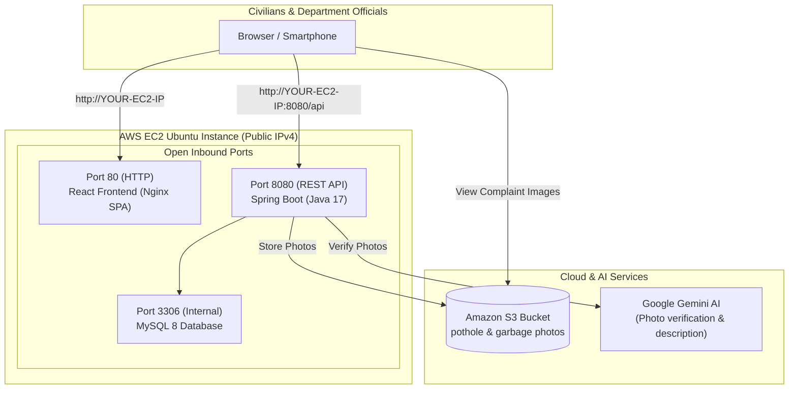

# 🚀 CivicFix — AWS EC2 IPv4 Deployment & Git Guide

This guide provides step-by-step instructions to deploy the **CivicFix** full-stack application (React Frontend + Spring Boot Backend + MySQL / AWS RDS + Google Gemini AI + Amazon S3) directly onto an **Amazon EC2 instance** accessible via its **IPv4 Public IP** (`http://<EC2-IPv4>`), with **no AWS Amplify required**.

---

## 📑 Table of Contents
1. [Architecture: EC2 IPv4 Deployment](#1-architecture-ec2-ipv4-deployment)
2. [Why Did Git Show `error: src refspec main does not match any`?](#2-why-did-git-show-the-error)
3. [Quick Git Push Commands](#3-quick-git-push-commands)
4. [Step 1: Launch & Configure AWS EC2 Instance](#step-1-launch--configure-aws-ec2-instance)
5. [Step 2: Setup Amazon S3 for Complaint Photos (Optional but Recommended)](#step-2-setup-amazon-s3-for-complaint-photos)
6. [Step 3: Deploy on EC2 via Git Pull & Docker](#step-3-deploy-on-ec2-via-git-pull--docker)
7. [Step 4: Access Your Live Application on EC2 IPv4](#step-4-access-your-live-application-on-ec2-ipv4)
8. [Step 5: Updating Anytime with `git pull`](#step-5-updating-anytime-with-git-pull)
9. [Location Specificity in Coimbatore (Eachanari, Gandhipuram, etc.)](#9-location-specificity-in-coimbatore)
10. [Troubleshooting & Firewall / Security Groups](#10-troubleshooting--firewall--security-groups)

---

## 1. Architecture: EC2 IPv4 Deployment



---

## 2. Why Did Git Show the Error?

When you ran:
```bash
git commit -m "first commit"
git push origin main
error: src refspec main does not match any
```

### The Root Cause:
Your project has its actual Git repository inside the **`civic`** subfolder:
- **`c:\Users\kevin\Desktop\civicFix\civic`** 👈 This is where `.git` is connected to `origin https://github.com/Kevin-13579/civic` on branch **`main`**.
- In the outer folder `civicFix`, git was on branch `master` with no remote origin set, which is why git gave `error: src refspec main does not match any` and reported `civic (modified content, untracked content)`.

---

## 3. Quick Git Push Commands

To commit and push all the changes to your GitHub repository:

Open PowerShell or Command Prompt:

```powershell
# 1. Navigate into the civic directory where the git repository lives:
cd c:\Users\kevin\Desktop\civicFix\civic

# 2. Stage all updated files (Dockerfiles, locationHelper, S3 service, etc.):
git add .

# 3. Commit the changes:
git commit -m "Update EC2 deployment, S3 storage, and Eachanari/Gandhipuram locality picker"

# 4. Push directly to GitHub main branch:
git push origin main
```

---

## Step 1: Launch & Configure AWS EC2 Instance

1. Log in to the **AWS Management Console** and search for **EC2**.
2. Click **Launch Instance**:
   - **Name**: `civicfix-server`
   - **OS Image**: **Ubuntu Server 22.04 LTS (HVM)**
   - **Instance type**: `t3.small` or `t3.medium` (recommended for running Java + MySQL + Node/Nginx smoothly). `t2.micro` can also be used with swap enabled.
   - **Key pair**: Create or select an existing `.pem` key pair (e.g. `civicfix-key.pem`).
3. Under **Network settings** (Security Group Rules), ensure the following inbound ports are checked:
   - ✅ **Allow SSH traffic** from anywhere (`0.0.0.0/0` or your IP) — Port `22`
   - ✅ **Allow HTTP traffic from the internet** — Port `80`
   - ✅ **Custom TCP Rule**: Port `8080` (Spring Boot API), Source: `0.0.0.0/0`
4. Click **Launch instance**.
5. Once running, click on your instance and note down your **Public IPv4 address** (e.g., `13.233.150.45`).

---

## Step 2: Setup Amazon S3 for Complaint Photos

1. Go to **AWS S3 Console** and click **Create bucket**.
2. Name it (e.g., `civicfix-uploads-yourname`) in `ap-south-1` (Mumbai).
3. Under **Block Public Access settings**, uncheck **Block all public access** (so citizens can view photos).
4. In the created bucket, go to **Permissions** -> **Bucket policy**, paste:
   ```json
   {
     "Version": "2012-10-17",
     "Statement": [
       {
         "Sid": "PublicReadGetObject",
         "Effect": "Allow",
         "Principal": "*",
         "Action": "s3:GetObject",
         "Resource": "arn:aws:s3:::YOUR_BUCKET_NAME/*"
       }
     ]
   }
   ```
5. Under **CORS configuration**, paste:
   ```json
   [
     {
       "AllowedHeaders": ["*"],
       "AllowedMethods": ["GET", "PUT", "POST", "HEAD"],
       "AllowedOrigins": ["*"],
       "ExposeHeaders": []
     }
   ]
   ```

*(Note: If you don't configure S3, the application automatically saves photos to local disk storage inside the EC2 container).*

---

## Step 3: Deploy on EC2 via Git Pull & Docker

### 1. Connect to your EC2 instance via SSH:
```bash
ssh -i "path/to/civicfix-key.pem" ubuntu@YOUR-EC2-PUBLIC-IP
```

### 2. Install Docker & Docker Compose:
```bash
sudo apt update && sudo apt install -y docker.io docker-compose git
sudo usermod -aG docker ubuntu
newgrp docker
```

### 3. Clone your GitHub repository:
```bash
git clone https://github.com/Kevin-13579/civic.git
cd civic
```

### 4. Create your `.env` configuration file:
```bash
nano .env
```
Paste your credentials (press `Ctrl+O` then `Enter` to save, `Ctrl+X` to exit):
```env
# Google Gemini Vision AI Key
GEMINI_API_KEY=your_gemini_api_key_here

# Amazon S3 Bucket (Optional: leave empty to use local disk storage)
AWS_S3_BUCKET_NAME=your-s3-bucket-name
AWS_REGION=ap-south-1
AWS_ACCESS_KEY_ID=your_aws_access_key
AWS_SECRET_ACCESS_KEY=your_aws_secret_key
```

### 5. Build and Start the entire application:
```bash
docker-compose up -d --build
```
This builds and starts:
- 🐬 **MySQL 8.0 Database** on port `3306`
- ☕ **Spring Boot 4 / Java 17 Backend** on port `8080`
- ⚛️ **React 19 + Vite Frontend (Nginx)** on port `80`

To verify everything is running:
```bash
docker ps
```
You will see `civicfix-frontend`, `civicfix-backend`, and `civicfix-mysql` in the `Up` status!

---

## Step 4: Access Your Live Application on EC2 IPv4

Open your web browser and navigate directly to:
```
http://YOUR-EC2-PUBLIC-IP
```
*(Example: `http://13.233.150.45`)*

The frontend automatically detects your EC2 IPv4 address and communicates with the backend on port `8080` (`http://YOUR-EC2-PUBLIC-IP:8080`) with zero extra configuration!

---

## Step 5: Updating Anytime with `git pull`

Whenever you make changes on your laptop and run `git push origin main`, update your EC2 server with two commands:

```bash
cd ~/civic
git pull origin main
docker-compose up -d --build
```
Docker will recompile only the updated files with zero downtime.

---

## 9. Location Specificity in Coimbatore

When testing the app:
1. **Auto-Detect GPS**:
   - Click **📍 Detect GPS** on the report page.
   - Reverse geocoding calculates proximity to Coimbatore's major centers and resolves to **`Eachanari, Coimbatore`** or **`Gandhipuram, Coimbatore`**.
2. **Quick-Pick Locality Buttons**:
   - One tap on **`[Eachanari]`** or **`[Gandhipuram]`** sets the locality immediately.
3. **Admin Dashboard Locality Filter**:
   - Municipal officials can filter complaints by **`Eachanari`**, **`Gandhipuram`**, or **`All Localities`**.

---

## 10. Troubleshooting & Security Groups

1. **Cannot connect to `http://YOUR-EC2-IP`**:
   - Go to AWS Console -> EC2 -> Instances -> Click your instance -> Security tab.
   - Click on the Security Group -> Edit inbound rules.
   - Verify rules for:
     - **Port 80 (HTTP)** from `0.0.0.0/0`
     - **Port 8080 (Custom TCP)** from `0.0.0.0/0`
2. **View Backend Logs**:
   ```bash
   docker logs -f civicfix-backend
   ```
3. **View Frontend Logs**:
   ```bash
   docker logs -f civicfix-frontend
   ```
